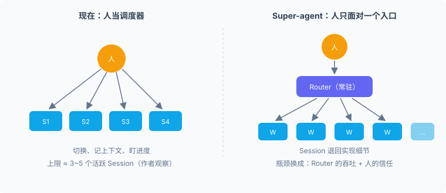
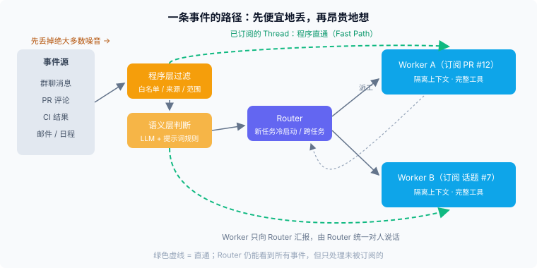
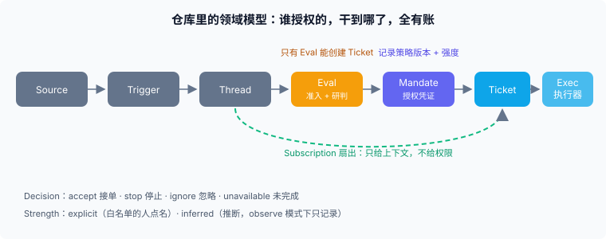
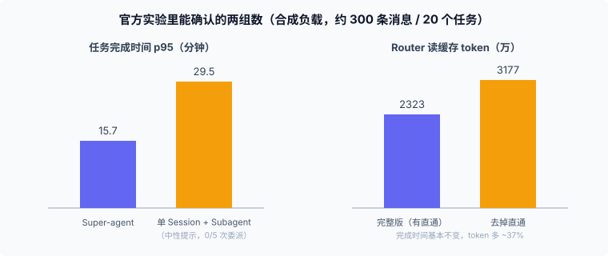

10 月 31 日（周六）晚上，DeepSeek Harness 团队发了一篇文章，叫《Super-agent 设计探索》，还把一个原型仓库 `dsh-superagent-prototype` 放到了 GitHub。我周末把文章和仓库里的文档都读了一遍。

先说我的总体印象：技术上几乎没有新东西，作者自己在结语里也承认"没有提出全新的理论"。Router、Cache、投机执行、存算分离、Watchdog，全是计算机系统课本里的东西。但我还是觉得值得认真写一篇，因为他们换了一个目标函数。

过去讨论 agent，几乎所有指标都围着"任务做得多好、多快"转。这篇文章开头第一段就把标尺换了：单任务的上限取决于模型，多任务的上限取决于人的注意力。他们内部观察，一个人同时只能跟进 3 到 5 个活跃 Session。

这句话我读到的时候停了一下，因为我自己现在就是这个状态。

## 先把它讲清楚：他们到底在做什么

你现在用 Claude Code 或 Codex，大概率是这样的：开一个终端窗口，布置一个任务，盯着它跑；再开一个窗口，布置另一个。到第四个窗口的时候，你已经想不起第二个窗口里它问了你什么，也不确定第一个是不是在等你点确认。

Super-agent 的思路是让这些窗口消失。用户只面对一个"同事"，在群里 @ 它，在 GitHub 的 PR 评论里回它，它自己决定要不要拉起新的执行会话、哪个会话接哪件事。Session 退回到实现细节，不再是用户要管理的东西。

他们把这个形态拆成四个特征：连续（感觉始终只有一个 agent）、高效（能并行，不被上一个任务堵住）、主动（不用逐条下指令）、持久（一直在线，出错能自己恢复）。然后给出五个模块来支撑：双层架构、事件驱动、面向人的交互、计算与状态与环境分离、Watchdog。

下面不逐个复述，挑我觉得值得停下来想的几处。

## 双层架构：Router 不干活

核心是把"维护全局连续性"和"高并发执行"拆开。常驻的 Router 负责和人说话、分派任务，甚至可以不配 Bash 工具；Worker 在隔离的上下文里干活，不直接对外发言，只向 Router 汇报。

这个结构乍看跟常见的 Agent Team 很像，作者专门区分了一下：传统的 Team Lead 要深入理解任务细节、拆步骤、高频协调成员，推理负担很重；Router 只处理任务之间的关系，不管单个任务内部怎么拆。我觉得这个区分抓得准。同样是"一个主、多个从"，差别在主会话有没有被允许碰具体活。

有一个细节我很喜欢。Router 是单个常驻 LLM Session，大家第一反应都是它会成为吞吐瓶颈。他们的答案不是加分片，而是利用批处理：上一轮推理期间到达的事件会积压，下一轮一次性注入。因为 Router 的每一步是长输入、短输出，积压多条在 prefill 阶段并行算，耗时增长远慢于条数增长。他们压测的数据是到达速率从每分钟 1 条涨到 40 条，平均 batch 从 1.0 到 2.8，单次请求耗时只从 2.5 秒到 3.9 秒，单个决定摊到的推理时间从 6.4 秒降到 1.6 秒。

这是个很工程的答案：先别急着拆，看看现有机制能不能扛。我认同这种克制，但需要说明一下，这个结论的前提是"目前的团队规模"，作者自己也写了，规模再大时分片不可避免，到时记忆连续性就要付代价。

## 事件驱动：便宜的先上，贵的后上

第二个我觉得有价值的点是事件处理的分层。群聊和代码平台的事件流是"高噪音、低触发率"的，每条都问一次大模型，延迟和成本都扛不住。所以先过一层程序规则（来源、群范围、白名单），再把候选交给 LLM 做语义判断。

更有意思的是订阅直通。Router 为某个 PR 或某个话题创建 Worker 之后，这个 Worker 就订阅了对应的 Thread，同一 Thread 后面的所有事件由程序直接送过去，不再经过 Router。Router 仍然能看到全部事件，但只处理没人认领的。

这个设计解决了两件事：一是 Router 不会因为一个长期运行的 PR 评审反复被打扰；二是多个 Worker 订阅同一个 Thread 时，它们能看到彼此的动作，不需要点对点通信就有机会发现冲突。

上下文管理那节，他们把窗口当 Cache 用：先给最少信息（对象 ID 加摘要），再按"时空局部性"内联相邻内容（消息的前后几条、回复的原消息），超过上限就截断并留续读入口（Inline & Spill）。每个对象互相带着 ID，模型可以顺着引用一跳一跳往外召回，他们叫它链式召回。这段读起来像在读一份缓存设计文档，其实就是缓存设计文档。

## 投机执行：最像"同事"的一个设计

我觉得文章里最有画面感的是这段：群里有人反馈问题，大家还在讨论方案，agent 已经在后台复现、尝试修复，只有确认了问题并找到简单修复才会交付，否则全程不吭声。

这就是 CPU 的投机执行：不确定结果会不会被采用，先花后台算力去跑，有用就交付，没用就丢弃。成本是 token，收益是人少等一轮。

但这里藏着一个只有"主动型"才有的新问题，我放到后面说。

## 异步 ReAct 和存算分离

另外两个模块我快速讲。

异步 ReAct：把耗时的命令改成 `start()` 和 `stop()`，调用后立刻返回"已启动"，完成时作为一条新事件投递回来。这样前台对话不会被后台任务阻塞。仓库的执行文档里也能看到对应实现：前台 shell 命令超过 5 秒就转后台，Worker 因此能在下一步就接到新消息。

存算分离：Agent Loop 做成无状态计算，放云端弹性容器；会话状态进数据库；执行环境留在原处，只在端侧装一个不存状态的轻量 daemon，只管执行命令、返回结果。这跟 Anthropic 提的"脑手分离"是一个方向，区别是他们要接入用户日常的、会间歇在线的个人机器（BYOM，Bring Your Own Machine）。

Watchdog 是个外部 Control Loop，由定时消息驱动一个独立会话，不只检查进程活没活，还让模型判断各 Worker 有没有实质进展、有没有偏离目标。这个我觉得很对，agent 的故障很多时候不是崩溃，是在原地打转。

## 仓库比文章更有意思

文章里没怎么展开的东西，在仓库的文档里写得更扎实。顺序读下来，000 号文档《Philosophy》只有一页，但读完后你会发现其余所有设计都是从它推出来的：

> 尽量少占用人的注意力，同时尽量创造价值。

一条消息、一次通知、一个设置项、面板上的一个元素、文档里的一段话，都会消耗某个人的注意力，每一项都必须提供比这更大的价值，否则就删掉。

从这条原则推下来，仓库里能抽出几条非常具体的规矩：

- 只有被点名或者团队写了规则允许的时候才行动。主动做的活，默认只"记录它本来会做什么"（observe 模式），确认合理再切到 auto。
- 只有人需要行动或能用上结果时才说话。聊天消息默认一句话，硬上限 100 词。
- 一次只问一个具体的问题，用结构化字段，不埋在长报告里。
- 吵的时候，把 prompt 写得更短更严，或者暂停它。文档里有句话我特别喜欢：不要靠多发消息去解释它为什么吵。

领域模型也值得看。Source 产出 Trigger，同一来源的 Trigger 按时间组成 Thread，Eval（先准入、再研判）决定要不要接单。接单就生成一张 Ticket，同时附带一份不可变的 Mandate（授权凭证），里面记录了依据哪个策略版本、授权范围、强度（是白名单的人点名的明确请求，还是 agent 自己推断的）。

这里有一条设计我认为是整套仓库里最重要的一句：订阅（Subscription）让后续消息扇出给 Ticket，但只给上下文，不给权限。权限只能来自 Mandate。

这解决了一个很实际的问题：一个 PR 评论区里，什么人都可能说话，包括机器人、CI、没在白名单的同事。这些消息进得去 Worker 的上下文，但不能让 Worker 因此多做事。

此外还有几个小细节，我觉得是"真的被生产环境打过"才会写出来的：Policy 变更时不会取消正在跑的 Ticket（会留下半成品），而是发一条通知让它自己判断；人说"暂停"之后，自动反馈永远不能把它恢复；自动 reviewer 每个 PR 最多回应三轮；打开 PR 不等于就绪，没有真实改动前截图的界面改动不算完成。

## 三个保留

下面是我的看法。前面是赞同，这里是保留。

### 保留一：那组实验证明的东西，比看起来窄

文章第 7 节的消融实验给了一个很漂亮的数字：Super-agent 的 p95 是 15.7 分钟，而带 Subagent 的单 Session 方案是 29.5 分钟。

但仔细读细节：在中性提示下，单 Session 方案 5 次实验里一次都没调用 Subagent，所有活都在主会话里做，不断被新消息打断，所以慢。换成"优先委派"的提示后，5 次里有 4 次委派了，成绩好一些，但仍然慢于 Super-agent，剩下 1 次它判断"活很小"选择自己干，形成长尾。

我的解读是：这组实验证明的是"不要指望模型在单会话里临场决定分不分工"，也就是把分工写进系统比写进提示词可靠。这是个真实且有用的结论。但它并不能直接推出"双层架构比任何单会话方案都好"，因为对照组的设计本身就是个比较弱的基线。另外，工作是用只消耗时间的工具替代的，实验衡量的是调度能力，不是任务质量。作者对这些都有交代，他们说得很坦诚，只是在转述里，这些限定条件很容易被丢掉。

还有一个数字被很多人会忽略：去掉直通之后，完成时间基本不变，但 Router 的决定次数多了约 30%，读缓存 token 从 2323 万涨到 3177 万，约 37%。也就是说直通机制不提高质量，提高的是成本效率。这是个朴素但可信的结论，我更愿意相信这种。

### 保留二：沉默是个很难审计的东西

整套设计的核心是"没必要就别说话"。我同意，但我想问一个问题：怎么知道它没说话是对的？

投机执行也一样，"只有确认问题并找到简单修复才交付，否则全程保持安静"。这意味着你永远看不到它试过但放弃了什么，也看不到它漏掉了什么。一个吵的 agent 容易发现，一个漏的 agent 不容易发现。

仓库对此是有补救的：每个 Trigger 的去向（被过滤、被评估、被扇出）都有记录（Disposition），observe 模式下"本来会接单"的判断也会记成"would accept"，可以回头复盘。面板的第二个问题就是"系统是否健康、是否在做对的事"。所以它不是没想到，而是把复盘的成本从"实时盯"挪到了"事后抽查"。

但我想说的是，这个成本没有消失，只是换了地方。节省的是被打扰的注意力，新增的是定期审阅的注意力。这笔账在团队小、信任高的时候划算；规模大了，谁来审阅、多久审一次，是需要明确分配的责任，而不是一个能自动解决的问题。仓库里"Responsibility"那一节写得很直白：agent 用你们团队每天都看得见的账号评论、开 PR、发消息，每一条消息都花同事的注意力，你要为它负责。

### 保留三：安全是靠规矩撑着的，不是靠机制

这一点文章第 8.4 节自己写得很重。事件驱动意味着 agent 被环境驱动，环境里什么人都有。再加上 BYOM，云端的 Agent Loop 连着一堆端侧设备，上面有私有代码和本地凭据。一旦云端被提示词注入攻破，所连接的设备都有风险。

原型仓库里能看到的缓解是：白名单、准入表、observe 默认。这些都是有效的，但属于"组织规则"，不是"技术隔离"。同时仓库文档里也直接写了，Executor Session 是以操作者的 OS 用户身份、不经审批地运行命令的。而架构文档的"开放问题"里，列在第一条的是：Trigger 的哪些字段可信（比如来源的 actor、Thread 归属），哪些不可信（比如正文和引用）。

这个问题没有答案。我并不是在批评，它本来就是一个研究原型，仓库首页就写着"Research prototype for reference only"。我想说的是，"主动型 agent"和"能被任何人的一句话驱动的 agent"之间，隔着的东西比"让它更聪明"要难得多。

## 这对我们意味着什么

我们团队的情况是：存量系统是一批 PHP，新能力统一用 golang，在建的是 agent 开放平台。从这个位置看，这篇文章有三条我觉得可以直接拿来用的：

第一，**observe 模式**。任何会主动行动的东西，上线第一阶段都应该只记录"本来会做什么"。这不需要任何框架，一个开关加一张表就行，但能省掉你最贵的东西：信任被透支之后的重建成本。

第二，**授权凭证和上下文分开**。让一个 agent 能读到某些信息，和让它有权据此行动，是两件事。Mandate 加版本号的写法，比"给它一个权限范围"精确得多，因为它能回答"这个动作当时是依据什么规则做出的"。

第三，**给它的话设预算**。100 词的硬上限、路由备注不超过 30 词，看起来像洁癖，实际是把"别烦人"从一个愿望变成了一个可检查的约束。

另一方面，有几处我们不会照搬。比如单个常驻 Router 加批处理，成立的前提是消息量和团队规模在可控范围，我们要先量一下自己的事件密度；BYOM 那部分，在我们把执行环境的凭据治理做扎实之前，不会碰。

## 最后

这篇文章最打动我的，不是某个模块，而是它的出发点：如果 agent 越来越能自己把活干完，那剩下的稀缺资源就是人的注意力。我们过去十年做软件，一直在优化机器的资源，CPU、内存、带宽、延迟。接下来可能要学会把"人被打扰的次数"也当成一种需要预算、需要审计、需要回收的资源。

这件事的难度可能不在技术。仓库里最动人的一句话，其实是 000 号文档最后一行：

> 目标是在正确的时间提供正确的帮助，其余时间什么都不做。

说起来容易。真正做到的 agent，会是那种你几乎注意不到它存在的 agent。到那时我们也许才会知道，它是真的好用，还是只是没出过声。

---

*参考：DeepSeek Harness 团队《Super-agent 设计探索：迈向更自主的 Agent 系统》（2026-10-31，公众号）；GitHub 仓库 `deepseek-ai/dsh-superagent-prototype`（MIT，研究原型，非官方产品；我看到时约 1.6k stars、仅 1 个提交）。文中实验数字来自原文，未做独立复现；仓库文档我通读了 000、001，002 到 005 读了主要章节，006 到 008 只看了目录与开放问题等少数部分。*
